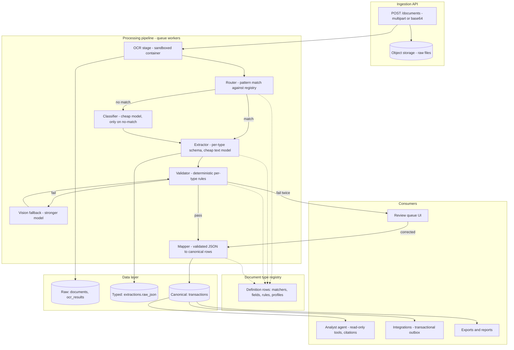
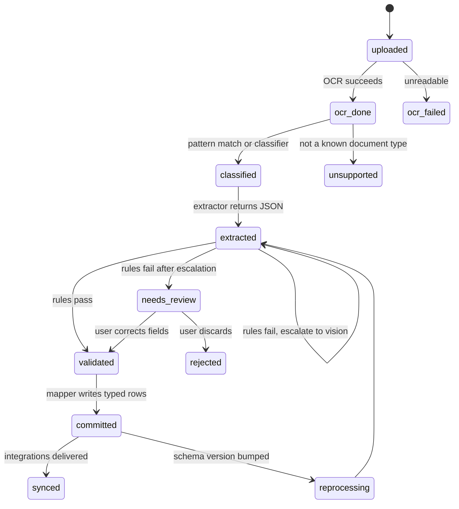
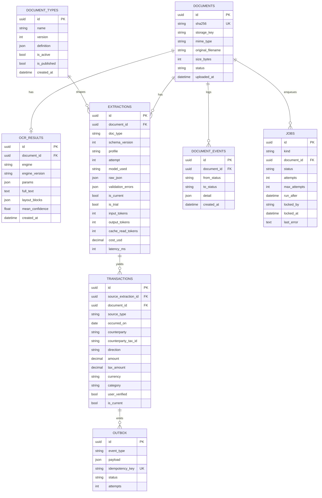

# Ledgerline

**A document ingestion pipeline for small-business finances, with a typed data layer and AI where it's actually needed.**

Upload receipts and invoices. Local OCR reads them, deterministic routing picks the document type, a cheap model extracts JSON against a strict schema, and deterministic code validates it before it becomes a ledger entry. A read-only analyst agent answers questions with citations back to the original documents. Integrations, exports, and anything else consume the same clean data.

The design principle: **models only where perception or judgment is required.** Everything else is code that can be unit-tested and never hallucinates.

> Status: **phases 1, 2 and 7 complete · phase 3 has its first baseline.** On 20 real
> till receipts, verified by hand: extraction gets **93.9%** of fields right, with totals,
> currency, tax ids and payment method at 100%, for about **$0.001 per receipt**. But
> routing accepts only **9 of 20**, so end to end the pipeline returns nothing for 11 of
> them. Details and every error by cause: [DESIGN §7.10](docs/DESIGN.md).
>
> English invoices, on 15 layouts held out from all tuning: **100% of fields** and
> **12/15 routed**, on clean synthetic data where 15 documents can't separate 100% from
> ~95%. The routing failures exposed two bugs, since fixed: [DESIGN §7.14](docs/DESIGN.md).

> **[Walkthrough: one receipt, start to finish](docs/WALKTHROUGH.md)** — how the pieces
> connect, file by file. Read this first.

> **[Technical design & decision record](docs/DESIGN.md)** — architecture, the full
> decision log with rejected alternatives, measured results, deviations from the original
> plan, and known gaps.

## Why this exists

Most "AI finance assistant" projects put a model in the loop for everything and can't tell you how accurate they are or what a document costs to process. This project is built the other way round:

- Extraction accuracy is **measured per field, per document type, per model tier** on a labeled set — `python -m evals.run --compare claude-sonnet-5` scores one corpus under two models and leads with what got worse
- Most documents never touch an expensive model — cheap extraction first, escalation only when deterministic validation fails
- Every model call is recorded with tokens, cost, and latency
- The analyst never does arithmetic; it calls deterministic tools over a canonical ledger and cites source documents — and because every tool is a read, "requires approval" is a capability it lacks rather than a rule it follows
- Anything that writes state requires human approval

## Architecture



Model calls happen in exactly three boxes — classifier, extractor, vision fallback — and two of them are fallbacks. Everything else is deterministic code.

## Document lifecycle

Every document has exactly one status. Every transition is logged to `document_events`. Every stage is idempotent, so a crashed worker can retry without duplicating anything.



`reprocessing` exists because schemas change and historical documents get re-run from stored OCR text — no re-upload, no re-OCR. `committed` and `synced` are separate because third-party delivery fails independently and must retry without touching the ledger.

**What the team sees.** The panel's Documents page lists every document with its
outcome, processor, amount and cost. Each document's page puts the original beside what
was extracted from it, then shows the timeline of stages with their durations, every
processor's routing score, every model call with its cost, and the OCR text.

**What a client system gets back.** `GET /documents/{id}/result` is the import side: an
ERP uploads a PDF, then polls this until `outcome` is no longer `processing`.

| Field | |
|---|---|
| `outcome` | `processing`, `done`, `needs_review`, `unsupported` or `failed`: the states a client branches on, mapped from the internal ones |
| `data` | every field the processor declares, normalised: `"7.15"` however the page printed it, dates as `YYYY-MM-DD`, `null` for what the document didn't carry. After the transform |
| `read`, `derived` | what the model read, and which fields the transform worked out, so a printed value can be told from a computed one |
| `problems` | why a document is waiting for review. `data` is still returned |
| `processor`, `transaction` | the processor version that read it, and the ledger row it became |

## Data model

Three layers. Raw is immutable evidence. Typed is the extracted JSON, shaped by a document type. Canonical is the only thing the analyst reads.



`documents`, `ocr_results`, `document_events` and `jobs` shipped in phase 1;
`document_types`, `extractions` and `transactions` are phase 2. `outbox` lands in
phase 8. `jobs` is the queue: a
worker claims a row, so there is no broker to run.

There are no per-document-type tables. `extractions.raw_json` **is** the typed layer: a
document type with fifty optional fields needs no columns, and a field is promoted to a
real column only when code has to act on it. `transactions` is exactly that promotion.

## Document types are data, not code

Adding a document type inserts a row in `document_types`. No module, no deploy — and
eventually no developer, which is the precondition for the phase-6 authoring UI. The
format is itself a Pydantic model, so `Definition.model_json_schema()` describes it and
the UI can generate its own form rather than hard-coding one.

```yaml
name: receipt
version: 1

# Deterministic routing. No model call, so scoring every registered
# type against every document costs nothing.
matches:
  keywords: [total, iva, ticket]
  patterns: ['\b[A-Z]\d{8}\b']   # structural signals, e.g. a tax id format
  min_score: 0.35                 # below this, not a match at all

fields:
  total:
    type: money                # -> Decimal, never float
    description: >-            # this string IS the extraction instruction
      The amount actually charged, labelled TOTAL.
      Not SUBTOTAL and not BASE IMPONIBLE.
    required: true
  issued_on:
    type: date
    description: The purchase date, usually printed beside the time.
  line_items:
    type: list
    description: One entry per purchased item.
    item_fields:
      name:   {type: string, description: The item name as printed.}
      amount: {type: money,  description: The line total for this item.}

rules:                         # deterministic, evaluated in code
  - {type: required,  field: total}
  - {type: positive,  field: total}
  - {type: not_future, field: issued_on, grace_days: 1}
  - {type: line_items_sum, list_field: line_items, item_field: amount,
     target: total, tolerance: 0.02}

profiles:                      # per-issuer overrides — earned, not authored upfront
  mercadona:
    tax_ids: ['A46103834']     # stable; a trading name is not
    descriptions:
      total: The figure after "TOTAL (€)", bottom right, below the card line.
```

One generic processor interprets all of it:

| Stage | What runs |
|---|---|
| Route | every active type is scored on whole-word keywords; of those above their own `min_score`, the most signals hit wins. Nothing matches → a model classifier |
| Profile | `select_profile()` identifies the issuer, tax id first, then name pattern |
| Extract | `build_json_schema()` renders the fields — descriptions included — and the API constrains the response to that schema |
| Transform | the type's own Python, if it has one, in a separate interpreter; anything it changes is marked derived |
| Validate | the rule list is evaluated deterministically; failures land in `extractions.validation_errors` |

**Field descriptions are the prompt.** Pydantic and the API pass `description` through
verbatim, which is why a per-issuer profile only needs to override descriptions to change
extraction behaviour — and why it must not change the field set. The target shape belongs
to the document type; only the layout belongs to the issuer.

**Rules are a closed vocabulary** — `required`, `positive`, `range`, `sum_equals`,
`line_items_sum`, `not_future`, `regex` — rather than an expression language. An analyst
picks from a fixed set in the UI, and every rule is independently testable.

**Arithmetic is a transform.** The model is told never to compute anything, so an invoice
that prints a subtotal and tax but no total comes back with the total null. A type can
carry Python for that, written inline or attached as a file beside the YAML:

```yaml
transform:
  file: invoice_transform.py      # defines transform(data) -> data
  examples:                       # run before a new version is stored
    - input:    {subtotal: "100.00", tax_amount: "20.00"}
      expected: {total: "120.00"}
```

It runs in its own interpreter (standard library only, no environment, a time limit),
its output goes through the same coercion and rules as the model's, and every field it
changed is recorded as derived on the extraction and on the ledger row. The model's
reading stays in `raw_json` untouched. [DESIGN §5.23](docs/DESIGN.md).

**Processors are authored in the panel** (`/panel`: sign in, see every processor, its
version history, each version as YAML, and a diff between any two) **or over the API**,
which the panel sits on. A new one can be **drafted by a model** from a plain-language
description and a sample: data only, never code, landing as a draft to review, try and
publish (`POST /processors/draft-with-ai`).

| | |
|---|---|
| `POST /processors` | start a draft, as JSON or seed YAML; `based_on_version` to edit an existing one |
| `PUT /processors/{name}/versions/{v}` | save over a draft (published versions never change) |
| `POST …/versions/{v}/trial` | try any version, drafts included, on a stored document or text: routing scores, extraction, errors, derived fields, cost |
| `POST …/versions/{v}/trial/file` | the same on an uploaded sample, read like a real document but not ingested |
| `POST …/versions/{v}/publish` | make it live; **409** if someone published since the draft was started |
| `POST /processors/{name}/retire` | stop routing to it; nothing is deleted |

Money is `Decimal`, never `float`. It crosses the wire as a string for exactly that
reason.

A type also says how it reaches the ledger, in the same file:

```yaml
canonical:
  direction: out          # a purchase: money leaving
  amount: total
  tax_amount: tax_amount
  occurred_on: issued_on
  counterparty: vendor
```

Only the fields the canonical layer has — everything else stays in
`extractions.raw_json`, which is what the raw layer is for. The mapping is data for the
same reason the rest of the definition is: a mapper written per type is a module per
type. A type with no `canonical` block is extracted and validated and simply stops
short of the ledger, which is right for one an analyst is still shaping.

## Roadmap

**Shipped:** ingestion and OCR (phase 1); processors as data, with routing, extraction,
validation, transforms and the ledger (2); the eval harness with a held-out set (3); the
`invoice` type and PDF text layers (part of 4); the analyst agent (7); processor
authoring with a panel, users, roles and Draft with AI (step 1); Postgres, containers
with isolated OCR, readiness checks, the result endpoint and CI (step 2, all but hosting);
the admin Documents page (3); multi-tenancy with Postgres row-level security and every
route checked for crossover (4).

**Next, in order** ([DESIGN §9](docs/DESIGN.md)):

| Step | Ships | Demonstrates |
|---|---|---|
| 5 | Client portal: each client sees only their own documents and results | The product's outside |
| 6 | Hosted demo on synthetic data | Production shape |
| 7 | Review queue and corrections; corrections become eval labels; duplicate detection; reprocessing | Human in the loop |
| 8 | Model classifier when no keyword matches; vision fallback; each tier's share, accuracy and cost measured | Cost engineering |
| 9 | Template agent drafting processors through the authoring API, scored on a fresh holdout; LangGraph only if its loop needs it | Agents, measured |
| 10 | Webhooks, per-client field names, CSV and accounting exports; per-document traces; rate limiting; PII redaction | Production shape |

The eval harness came before any orchestration, so every later step is argued with
before/after numbers rather than asserted.

## Stack

- **API:** Python 3.12, FastAPI, SQLAlchemy 2.0, Alembic
- **Tooling:** uv for dependencies and virtualenv, ruff for lint and format, pytest
- **DB:** Postgres 17; SQLite (WAL mode) for zero-setup local work and the fast test run. The suite runs on both
- **Queue:** DB-backed `jobs` table polled by a worker (Redis later if needed)
- **OCR:** self-hosted, behind an `OcrEngine` protocol, in its own container (PP-OCR models on ONNX Runtime; Tesseract as test double). Born-digital PDFs skip recognition: the container reads their embedded text layer, exactly, in milliseconds, so untrusted files are only ever parsed where there are no credentials
- **Models:** Anthropic API behind an `Extractor` protocol, using structured outputs; cheap tier for extraction, strong tier for fallback and analysis
- **Orchestration:** LangGraph, if the template agent's loop earns it (roadmap step 5)
- **Infra:** Docker Compose

## Design decisions and tradeoffs

- **OCR-first, vision as fallback.** Text extraction is cheaper and more reproducible than vision; routing on OCR text is free. Vision handles the long tail.
- **Per-type schemas, not one universal JSON.** Receipts, invoices, and statements are different shapes with different validation rules.
- **Document types are rows, not modules.** A definition is a value, so versioning is a new row and adding a type needs no deploy. The cost is a closed rule vocabulary instead of arbitrary per-type logic, and JSON instead of per-type columns.
- **No code sandbox for extraction.** Structured outputs constrain the response to the JSON Schema directly, so the model can't do anything but return JSON. Sandboxing is reserved for parsing untrusted files and for model-generated parser templates (phase 6).
- **Analyst never computes.** Arithmetic lives in deterministic tools. The model interprets and explains.
- **LangGraph is one component, not the architecture.** Provider layer, tool registry, budgets, tracing, and evals all live outside the graph.
- **Sensitive data.** Documents never leave local infrastructure until the extraction step. Encryption at rest and PII redaction before analyst context are planned.
- **Keys for machines, accounts for people.** Machines send an API key (SHA-256 is enough for 256 random bits); people sign in to the panel with a password (argon2id, because people choose guessable ones) and get a server-side session, revocable at once, with CSRF protection. Two roles: *authors* draft and trial-run processors, *admins* publish them. Still not tenancy: no table has an owner column, so anyone who gets in sees everything.

## Local development

Requires [uv](https://docs.astral.sh/uv/) and Python 3.12.

```bash
git clone <this repo>
cd ledgerline
uv sync                            # creates .venv, installs from uv.lock
cp .env.example .env               # ANTHROPIC_API_KEY is only needed from phase 2 on
uv run alembic upgrade head        # creates ./data/ledgerline.db
uv run python -m doctypes.seed     # creates the starter processors; never overwrites panel edits
uv run python -m core.auth create "local" --role admin   # prints a key, once
uv run python -m core.users create you@example.com --role admin   # a panel login (team staff)
uv run uvicorn api.main:app --reload
# docs at http://127.0.0.1:8000/docs, the panel at /panel, health check at /health
```

Each processor is for every organisation or only the ones granted it; a new one is for
nobody until an admin says otherwise, on its panel page. Clients are organisations:
`uv run python -m core.tenancy create "Acme Ltd" acme`, then
`--client acme` on the two commands above for that client's user or ERP key. Without it,
users are the Ledgerline team (staff, who see every organisation) and keys belong to the
team's own organisation, "Ledgerline demo".

The panel's session cookie is `Secure`, so it is only sent over https. Chrome and Firefox
make an exception for `localhost`; Safari may not, which looks like signing in and landing
back on the form. For plain-http local work, add `SESSION_COOKIE_SECURE=false` to `.env`
and restart. Never in a deployment.

`docker compose --profile dev up -d` starts Postgres and the OCR container for this
workflow. To run on Postgres rather than SQLite, use the `DATABASE_URL` shown in
`.env.example`. The test suite runs on either: it uses SQLite
unless `TEST_DATABASE_URL` points it at Postgres (create the database first with
`docker exec ledgerline-db createdb -U ledgerline ledgerline_test`).

CI (`.github/workflows/ci.yml`) runs all of the below on every push: lint, the suite on
SQLite and on Postgres, every migration up and back down on both, and both images built
and checked (non-root, no secrets or private data inside).

Lint and tests:

```bash
uv run ruff check .
uv run pytest              # ~930 tests, ~15s; no container, tesseract, network or API key
```

Measuring extraction against a labelled corpus:

```bash
uv run python -m evals.run --draft-labels   # model drafts labels for you to correct
uv run python -m evals.run --dry-run        # validate the labels, no API calls
uv run python -m evals.run                  # score them, per field
uv run python -m evals.run --compare claude-sonnet-5   # two models, diffed
```

What it has cost, including calls that were billed but produced nothing:

```bash
uv run python -m core.costs --since 2026-10-01     # or GET /costs
```

Drafts are written `verified: false` and the runner will not score them until a human
has checked each field against the document and said otherwise.

### Everything in containers

The deployment shape, on one machine:

```bash
docker compose --profile app up -d --build
docker compose --profile app run --rm api python -m core.auth create "me" --role admin
docker compose --profile app run --rm api python -m core.users create you@example.com --role admin
# the API and panel on http://localhost:8080; readiness at /ready
```

A one-off `migrate` service runs the migrations and creates the starter processors, and
the API and worker start only once it has succeeded, from the same image. The worker
also waits for the schema itself, so a worker started early never runs against an old
one. The OCR container sits on a Docker network with no route out: it can reach neither
the internet nor the database, which the full stack was checked for. `/health` is
liveness; `/ready` answers 503 until the database is at the migration the code expects.

---
